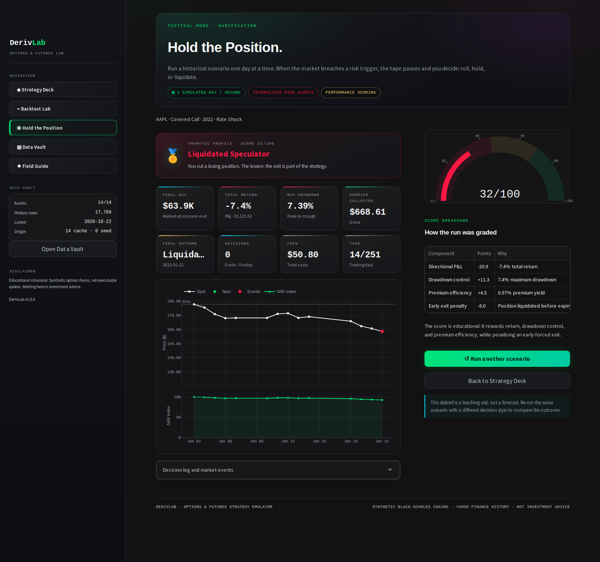
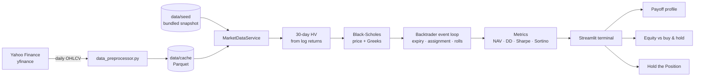

<div align="center">

# 📈 DerivLab

### Options & Futures Strategy Emulator

**Learn, configure, and stress-test advanced trading strategies using synthetic option chains built from real market history.**

[](https://www.python.org/)
[](https://streamlit.io/)
[](https://www.backtrader.com/)
[](https://www.docker.com/)
[](https://code.visualstudio.com/docs/devcontainers/containers)
[](LICENSE)

[Quick Start](#-quick-start-run-anywhere-via-docker) ·
[Dev Containers](#-vs-code-dev-containers-for-a-distributed-team) ·
[How it works](#-how-it-works) ·
[Screens](#-a-tour-of-the-terminal) ·
[Testing](#-testing) ·
[Auto-start policy](#-containers-do-not-start-on-server-reboot)

</div>

<p align="center">
  <a href="docs/screenshots/backtest-lab.png">
    
  </a>
</p>

---

## Why DerivLab?

DerivLab is a self-contained teaching terminal for delta-neutral and option-income
strategies. It combines three ideas that are usually hard to demonstrate together:

1. **Real history, no expensive data feed.** It downloads five years of daily spot
   history through `yfinance` and synthesizes option chains with Black-Scholes.
2. **Event-driven realism.** A Backtrader loop handles daily marks, expirations,
   assignment, rolling, fees, and a full trade ledger.
3. **A demo that cannot fall over.** A bundled seed snapshot, local Parquet cache,
   deterministic offline fallback, and friendly error surfaces keep every screen
   usable even when Yahoo Finance rate-limits or the network is down.

It is intentionally **not** a trading system. It is a visual laboratory for
understanding basis, premium, theta, vega, assignment, and the trade-off between
income and drawdown.

---

## ✨ Highlights

| | |
|---|---|
| **14 instruments** | US and European equities, FX, gold, Brent, and four indices from the SRS universe. |
| **5 strategies** | Basis Trade, Covered Call, Cash-Secured Put, Long Straddle, and Iron Condor. |
| **Synthetic option chain** | Black-Scholes prices plus Delta, Gamma, Theta, Vega, and Rho at every simulation step. |
| **Backtrader event loop** | Daily data feed, expiry clock, whole-lot sizing, transaction costs, and a private portfolio ledger. |
| **Payoff + equity** | Interactive expiration P&L, break-evens, max risk/reward, equity curve against buy & hold, drawdown, and cycle P&L. |
| **Institutional KPIs** | Total return, CAGR, max drawdown, Sharpe, Sortino, win rate, profit factor, Calmar, premium collected, and fees. |
| **“Hold the Position” game** | One simulated day per second, live risk alerts, roll/hold/liquidate decisions, and a thematic performance badge. |
| **Financial cyberpunk UI** | Mandated dark palette, neon emerald/pink signals, terminal typography, and responsive KPI blocks. |
| **Docker + Dev Containers** | Reproducible on Windows, macOS Intel, Apple Silicon, and Linux. No host paths or manual setup. |
| **Offline-first data** | `data/seed` ships with the repository; `data/cache` is per-machine and gitignored. |
| **No API keys** | yfinance is free; no broker connection, credentials, or paid option data required. |

---

## 🚀 Quick Start (Run Anywhere via Docker)

Ensure you have [Docker](https://docs.docker.com/get-docker/) with Compose v2,
then run:

```bash
git clone https://github.com/<your-org>/DerivLab.git
cd DerivLab
docker compose up --build
```

Open **<http://localhost:8501>** in your browser.

The first build takes a few minutes (native build tools are isolated in a
builder stage). The app starts from the bundled five-year seed, so it works even
without internet access. When you want fresh history, open **Data Vault →
Refresh all (5Y)** or run:

```bash
docker compose --profile seed run --rm derivlab-seed
```

> Legacy Compose v1 users can substitute `docker-compose` for `docker compose`.
> The cache is stored in the named Docker volume `derivlab-cache`, so it
> survives `docker compose down`, container deletion, and image rebuilds.

### Docker cheat sheet

```bash
docker compose up --build -d     # start in the background
docker compose logs -f           # follow app logs
docker compose down              # stop and remove containers (cache stays)
make docker-verify               # assert restart policy is "no"
```

To expose the terminal on a LAN interface intentionally:

```bash
DERIVLAB_BIND_ADDR=0.0.0.0 docker compose up --build -d
```

The default bind address is `127.0.0.1` on purpose.

---

## 🔒 Containers do not start on server reboot

Requirement: the app’s containers and services must **not** start by default
when the server reboots. That is enforced in three places:

1. Every Compose service declares `restart: "no"` explicitly. There is no
   `always` or `unless-stopped` policy anywhere in `docker-compose.yml`.
2. No systemd unit, cron job, or supervisor configuration starts DerivLab.
3. The Dev Container uses `"shutdownAction": "stopContainer"` and its
   `postStartCommand` only prints instructions — it does not launch Streamlit.

After a reboot you start the stack manually:

```bash
docker compose up -d
```

`make docker-verify` inspects the running container and fails unless the restart
policy is `no`. The CI suite also checks the Compose file for accidental
auto-restart policies.

> The Docker daemon itself may be enabled at boot by your operating system;
> that is separate from DerivLab. These policies guarantee that DerivLab
> containers remain stopped until a human starts them.

---

## 🧑‍💻 Local Development

Python **3.10+** is required. The Docker image and CI pin Python 3.10 to match
the SRS; Python 3.12 is also tested locally.

```bash
python3.10 -m venv .venv
source .venv/bin/activate            # Windows: .venv\Scripts\activate
pip install -r requirements-dev.txt

# Optional: inspect the bundled data inventory
python -m derivlab.data_preprocessor --check

streamlit run app.py
```

Open <http://localhost:8501>.

### Refresh the data

```bash
python -m derivlab.data_preprocessor --all --years 5 --output both
```

This downloads five years of daily OHLCV for all 14 instruments, writes a
normalized Parquet cache, and promotes the successful files into `data/seed`.
The script retries transient failures and never deletes a good local file when a
download fails.

### Useful environment variables

| Variable | Default | Purpose |
|---|---|---|
| `DERIVLAB_DATA_DIR` | `./data/cache` | Runtime cache location |
| `DERIVLAB_SEED_DIR` | `./data/seed` | Bundled fallback snapshot |
| `DERIVLAB_PORT` | `8501` | Host port for Docker Compose |
| `DERIVLAB_BIND_ADDR` | `127.0.0.1` | Host bind address for Compose |
| `STREAMLIT_SERVER_FILE_WATCHER_TYPE` | `auto` | Set `none` in production images |

---

## 🧰 VS Code Dev Containers for a Distributed Team

The repository includes a complete `.devcontainer/` setup for the Microsoft
**Dev Containers** extension. It is designed for developers on different laptops:

- **Same environment everywhere.** Python 3.10, pinned requirements, system
  libraries, VS Code extensions, tasks, and debugging are committed.
- **No machine-specific paths.** The workspace is mounted through
  `${localWorkspaceFolder}`; there is no `/Users/...` or `/home/...` hardcoding.
- **Each developer gets an isolated cache.** `data/cache` is local and
  gitignored; the shared seed is versioned.
- **No automatic app start.** The post-start script only prints the run command.
- **Port forwarding.** VS Code forwards `8501` automatically.

### Open it

1. Install Docker and the
   [Dev Containers extension](https://marketplace.visualstudio.com/items?itemName=ms-vscode-remote.remote-containers).
2. Clone the repository and open the folder in VS Code.
3. Run **Dev Containers: Reopen in Container** from the Command Palette.
4. In the container terminal:

   ```bash
   streamlit run app.py --server.port 8501
   ```

   or run the VS Code task **DerivLab: run Streamlit** from the Command Palette.

5. Run tests with `make test` or the **DerivLab: run tests** task.

See [`.devcontainer/README.md`](.devcontainer/README.md) and
[CONTRIBUTING.md](CONTRIBUTING.md) for team workflow details.

---

## 🖥️ A Tour of the Terminal

### 1. Strategy Deck — learn before you trade

The left navigator selects one of five playbooks. The right-hand educational
card explains the goal, core concept, step-by-step mechanics, ideal market, risk
level, and primary risks. All copy is in English and stored in a single
`STRATEGY_EDU_DB` dictionary for easy editing.

<p align="center">
  
</p>

### 2. Backtest Lab — configure and read the risk

The trade builder gives you asset, strategy, strike preset, expiration, capital,
volatility multiplier, risk-free rate, fees, and lookback. The payoff chart and
the historical equity curve update together, followed by institutional KPI
blocks and a full trade ledger.

<p align="center">
  
</p>

### 3. Hold the Position — manage a live scenario

This is the gamified stress-test mode. Playback advances **one trading day per
second**. When spot breaches a short strike or the drawdown threshold, the tape
pauses and a decision terminal appears:

- **Roll** the option legs to a fresh strike/expiration,
- **Hold** and let the contract ride, or
- **Liquidate** the underlying and every derivative leg.

Every run ends with a 0–100 score and a thematic badge such as **Yield
Generator**, **Prudent Hedger**, or **Liquidated Speculator**.

<table>
  <tr>
    <td width="50%"></td>
    <td width="50%"></td>
  </tr>
  <tr>
    <td align="center"><em>Risk alert · playback paused</em></td>
    <td align="center"><em>Debrief · score, badge, and breakdown</em></td>
  </tr>
</table>

### 4. Data Vault — real history, local first

Inspect coverage, freshness, HV30, and provenance for all 14 instruments. Refresh
one symbol or the full universe; failures keep the last good cache and never
break the demo.

<p align="center">
  
</p>

### 5. Field Guide — the vocabulary

Greeks, contango, assignment, rolling, Sharpe/Sortino, the scoring model, and an
honest list of simplifications. Useful as a teaching handout.

---

## 🧠 How it works



### Data pipeline

- `yfinance` downloads adjusted daily OHLCV for all 14 SRS instruments.
- Frames are normalized, deduplicated, sorted, and saved as Parquet (CSV gzip
  fallback is supported if Parquet is unavailable).
- HV is the annualized standard deviation of daily log returns over a 30-day
  window; the synthetic implied volatility is `HV30 × multiplier`, floored at 5%
  and capped at 250%.
- Prices and P&L are expressed in the instrument’s **quote currency** (USD, EUR,
  or JPY). No cross-currency conversion is applied, which keeps every simulation
  internally consistent.

### Black-Scholes engine

`derivlab/option_math.py` prices European calls and puts with continuous
dividend yield, returns Delta/Gamma/Theta/Vega/Rho, solves implied volatility
with Brent’s method, and handles expired, zero-volatility, and missing inputs
without raising. Theta is quoted per calendar day and vega per volatility point.

### Simulation engine

Backtrader’s `Cerebro` drives the daily event loop. Option legs are synthetic, so
the engine tracks them in a private ledger rather than a broker order book:

- whole simulated lots sized from the capital allocation,
- mark-to-market NAV at every close,
- settlement at intrinsic on the first trading day after expiry,
- covered-call assignment and cash-secured-put assignment,
- automatic rolls for repeating strategies,
- a per-leg bps cost model,
- complete trade, cycle, and event ledgers.

A direct-loop fallback keeps the app usable if a future Backtrader release
breaks. The result is labeled `direct-fallback`; in normal operation the engine
is `backtrader` (checked by tests).

### Hold the Position

The game reuses the same option math and ledger but exposes tactical decisions.
Risk triggers include short-strike breaches, drawdown thresholds, large moves,
and capital loss. Holding suppresses a trigger until its condition clears.
Rolling closes the current legs and re-opens at a fresh strike/expiry. The final
score blends P&L, maximum drawdown, and premium efficiency; badges describe
behaviour, not a recommendation.

---

## 📚 The five strategies

| Strategy | What the simulator does | Ideal market | Risk profile |
|---|---|---|---|
| **🔗 Basis Trade** | Buys spot and shorts a synthetic future at a contango premium; captures convergence and rolls the future. | Bullish / high-volatility regimes with a wide futures premium. | 🟢 Low / delta-neutral. Execution and counterparty risk remain. |
| **🛡️ Covered Call** | Holds one lot of shares and sells an OTM call each expiry; keeps the premium or records assignment. | Flat, sideways, or mildly bullish. | 🟡 Medium. Full downside of the shares; upside capped at the strike. |
| **💵 Cash-Secured Put** | Reserves cash and sells an OTM put each cycle; collects premium until assignment, then holds the shares. | Neutral to mildly bullish, or waiting for a discount. | 🟡 Medium. A crash still forces purchase at the strike. |
| **⚡ Long Straddle** | Buys an ATM call and put together, paying a debit, and resets the position each expiry. | A large move with unknown direction. | 🟠 Medium-high. Time decay and IV crush can hurt even on a move. |
| **🕸️ Iron Condor** | Sells an OTM call and put spread, with long wings capping risk; collects net credit in a range. | Low-volatility, range-bound markets. | 🟡 Medium. A breakout can hit the maximum loss. |

Every strategy uses the same synthetic chain, fee model, and settlement clock, so
comparisons are fair.

---

## ⚙️ Configuration reference

| Control | Values | Notes |
|---|---|---|
| Asset | 14 SRS instruments | US/EU equities, FX, gold, Brent, indices |
| Strategy | 5 playbooks | Basis, covered call, cash-secured put, long straddle, iron condor |
| Strike selection | ATM, 5–10% OTM/ITM | Signed distance from spot; presets follow the option direction |
| Expiration | 30 / 60 / 90 days | ACT/365 pricing; settlement on the first trading day after expiry |
| Capital | Whole simulated lots | Sizing respects collateral for CSP, debit for straddles, and max loss for condors |
| IV multiplier | 0.4× – 2.0× | Synthetic IV = HV30 × multiplier |
| Risk-free rate | 0% – 10% | Anchored to US Treasury / ECB / BoJ indicators, editable |
| Costs | 0 – 50 bps | Charged per leg at entry, settlement, and roll |
| Lookback | 1 / 3 / 5 years | Uses only locally cached daily bars |
| Condor distance / width | 2–20% / 1–10% | Short strikes and protective wings |
| Basis premium | 0–15% annualized | Extra contango beyond cost of carry |

One lot is a **simulation unit**, not an exchange contract specification:
100 shares for equities, 10,000 units for FX, 10 troy ounces for gold, 100
barrels for Brent, and 1 index unit for indices.

---

## 🛡️ Reliability & graceful degradation

The demo is designed to survive a live presentation:

- **Network failure** → keep the cache; fall back to the bundled seed; only then
  use clearly labelled deterministic synthetic data.
- **Yahoo rate limit** → retries with backoff, then a friendly Data Vault report.
- **Missing data** → the app never crashes; Data Vault shows the source and status.
- **Invalid parameters** → every option configuration is clamped or reported;
  a low capital allocation shows a “below one lot” warning with a one-click fix.
- **Backtest errors** → the UI shows a friendly message, not a traceback.
- **Backtrader regression** → a direct event-loop fallback produces the same
  simulation and labels the engine.
- **Streamlit cache** → backtests are cached and invalidated when the data
  revision changes, keeping the UI responsive.
- **Container restart** → explicitly disabled (`restart: "no"`), with a test to
  prevent regressions.

---

## 🧪 Testing

The suite runs fully offline against the bundled seed:

```bash
make test          # or: python -m pytest -q
make lint          # ruff
```

Coverage includes:

- **Black-Scholes:** put-call parity, known ATM values, Greeks signs,
  degenerate inputs, implied-volatility roundtrip, synthetic futures.
- **Data layer:** yfinance MultiIndex normalization, HV, cache/seed precedence,
  stale-cache fallback, network failure handling, manifest, purge.
- **Plans & payoffs:** all **14 assets × 5 strategies**, premium signs,
  break-evens, max profit/loss, explicit contracts, extreme parameters.
- **Backtests:** the full **70-combination matrix**, lookback windows, zero-lot
  capital, extreme rates/fees/strikes, synthetic data, short history.
- **Game:** scenario slicing, alerts, hold/roll/liquidate, assignment and
  completion paths, scoring, low-capital errors.
- **UI:** Streamlit `AppTest` walks every page, all strategies, several assets,
  the game flow and debrief, low-capital warnings, Data Vault, and Field Guide.
- **Deployment:** Compose restart policy, multi-stage Dockerfile, Dev Container
  JSON, executable post-create scripts, seed completeness, README, screenshots.

GitHub Actions runs lint + tests on Python 3.10 and builds/smoke-tests the Docker
image on every push and pull request.

---

## 📁 Project structure

```text
DerivLab/
├── app.py                       # Streamlit entry point
├── derivlab/
│   ├── config.py                # Asset universe, palette, education copy
│   ├── data_fetcher.py          # yfinance download, cache, HV, fallbacks
│   ├── data_preprocessor.py     # CLI: seed/refresh five years of data
│   ├── option_math.py           # Black-Scholes prices, Greeks, implied vol
│   ├── strategies.py            # Legs, sizing, payoff profiles, Greeks table
│   ├── backtest_engine.py       # Backtrader event loop + portfolio ledger
│   ├── game_mode.py             # Hold-the-Position state machine and scoring
│   ├── metrics.py               # Sharpe/Sortino/MDD and game score
│   ├── charts.py                # Plotly payoff, equity, price path, gauge
│   ├── theme.py                 # CSS, terminal components, KPI blocks
│   └── ui.py                    # Five screens and navigation
├── data/
│   ├── seed/                    # Committed 5Y demo snapshot (Parquet)
│   └── cache/                   # Per-machine runtime cache (gitignored)
├── tests/                       # Offline pytest + AppTest suite
├── .devcontainer/               # Reproducible Dev Container + scripts
├── .vscode/                     # Tasks, debugging, recommended extensions
├── docs/screenshots/            # README screenshots
├── Dockerfile                   # Multi-stage python:3.10-slim image
├── docker-compose.yml           # app + optional seed profile, restart: "no"
├── Makefile
├── pyproject.toml               # pytest + ruff configuration
└── README.md
```

---

## 🧭 Suggested demo script

1. **Strategy Deck:** select **Covered Call** and read the educational card.
2. **Backtest Lab:** switch to **AAPL**, keep 30 days and 5% OTM, then compare
   the payoff and equity curve. Change IV or fees to show the sensitivity.
3. **Hold the Position:** launch **AAPL / Covered Call / 2022 Rate Shock**, press
   **Fast-forward → alert**, then demonstrate **Roll**, **Hold**, and
   **Liquidate** in separate runs.
4. **Data Vault:** show the 14/14 inventory, source provenance, and the refresh
   controls. Mention that the seed keeps the demo offline-safe.
5. **Field Guide:** close with the Greeks and the limitations card.

---

## 🩺 Troubleshooting

| Symptom | Fix |
|---|---|
| Port 8501 already in use | Stop the other process or `DERIVLAB_PORT=8502 docker compose up` |
| Docker build is slow on first run | Expected: the builder installs compilers and wheels once; later builds use the layer cache |
| App shows “Synthetic fallback” | The cache/seed were missing and the network failed. Open Data Vault → Refresh |
| Refresh fails with 429 | Yahoo is rate-limiting. Keep the existing cache; retry later or use the seed |
| “Below one lot” warning | Increase capital or choose a cheaper instrument; the warning includes a one-click fix |
| Dev Container permission error | Rebuild the container; post-create re-creates `data/cache` with the developer UID |
| Want to reset the demo data | `docker compose down -v` (removes the cache volume) then `up --build` |
| Need LAN access | `DERIVLAB_BIND_ADDR=0.0.0.0 docker compose up` and use the host IP |

---

## ⚠️ Limitations & disclaimer

DerivLab uses **synthetic Black-Scholes option chains**, not executable quotes.
There is no bid-ask spread, no real open interest, no volatility surface across
strikes, and no early exercise of American options. Fees are a flat bps charge.
Margin calls, borrow costs, taxes, dividend timing, and exchange-specific
contract specifications are simplified or omitted. The basis trade uses an
idealized frictionless convergence hedge, so its risk-adjusted ratios are an
upper bound.

**Educational simulator only. Synthetic option chains are not executable market
quotes. This is not investment advice and nothing in this repository is a
recommendation to trade.**

Market data is sourced from Yahoo Finance via `yfinance` and is subject to Yahoo’s
terms. The bundled seed is a point-in-time snapshot for demonstration and
offline reproducibility.

---

## 📄 License

Released under the [MIT License](LICENSE).

Built with [Streamlit](https://streamlit.io/), [Backtrader](https://www.backtrader.com/),
[Plotly](https://plotly.com/python/), [pandas](https://pandas.pydata.org/),
[NumPy](https://numpy.org/), [SciPy](https://scipy.org/), and
[yfinance](https://github.com/ranaroussi/yfinance).
