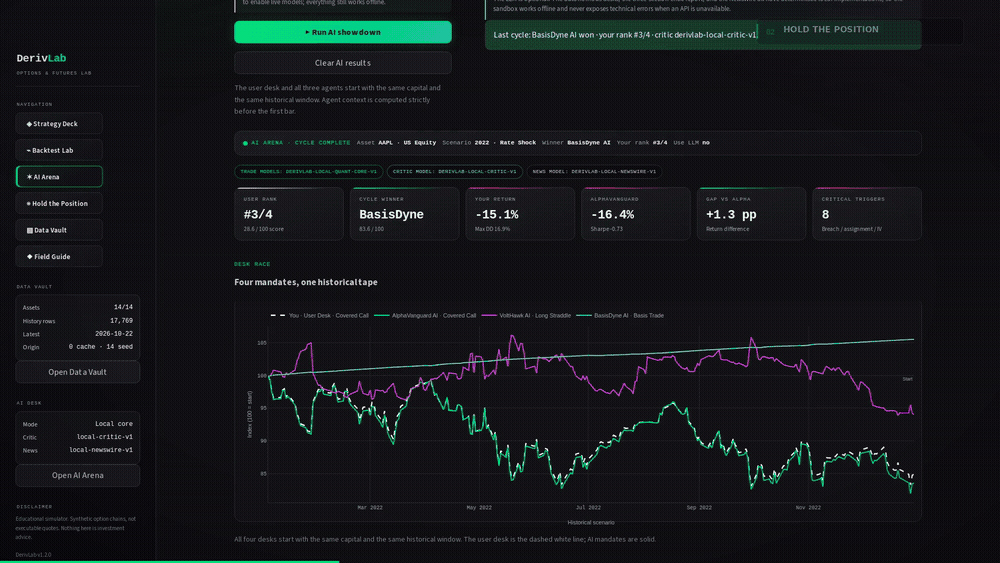
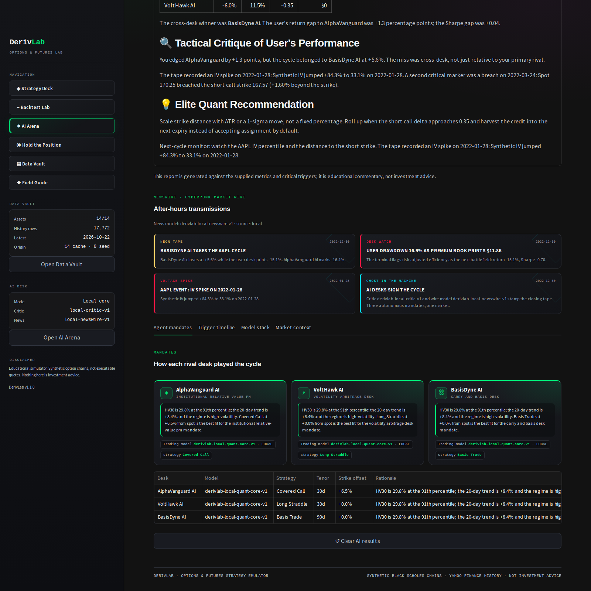
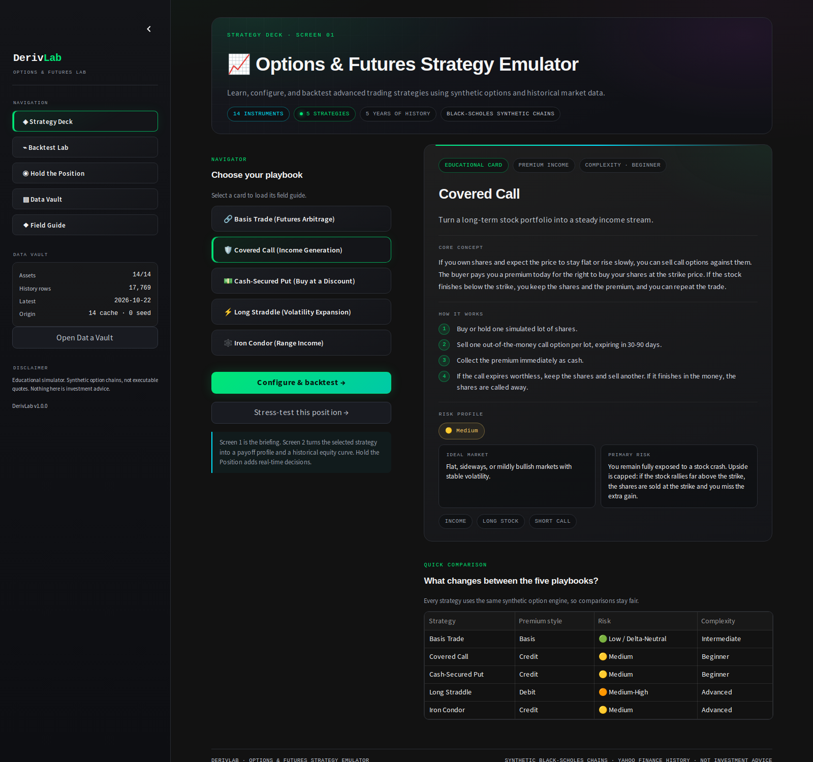
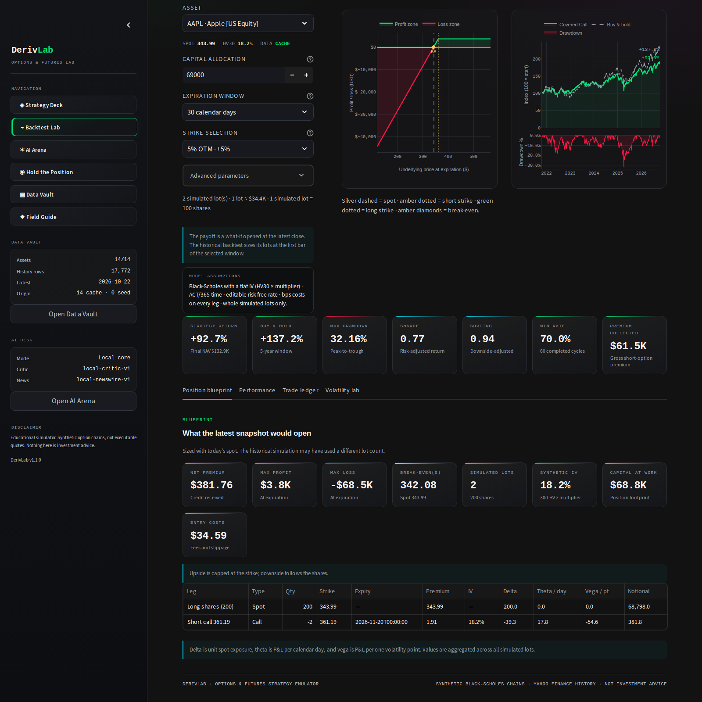
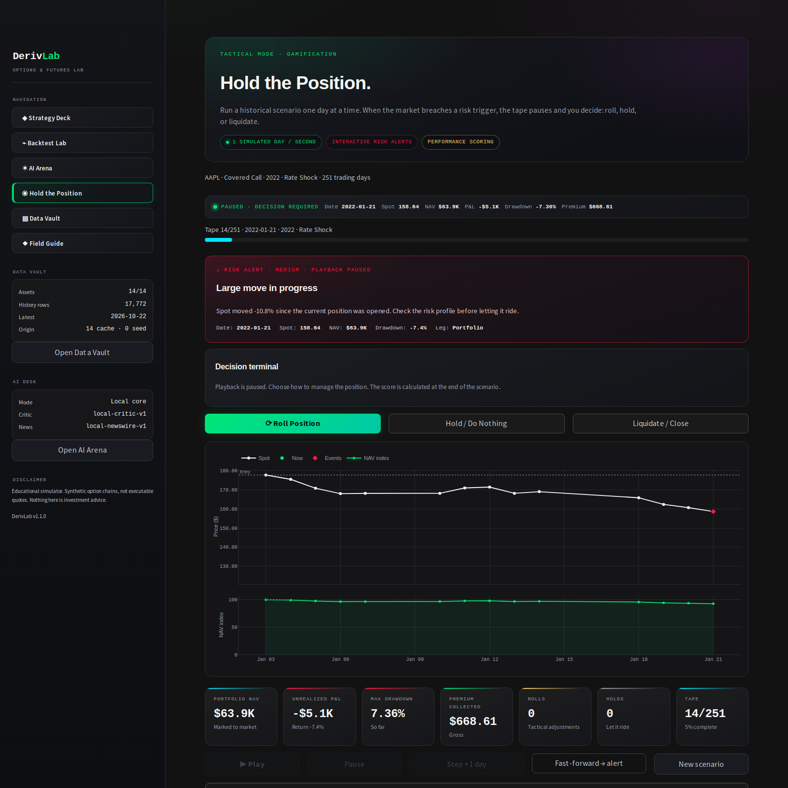
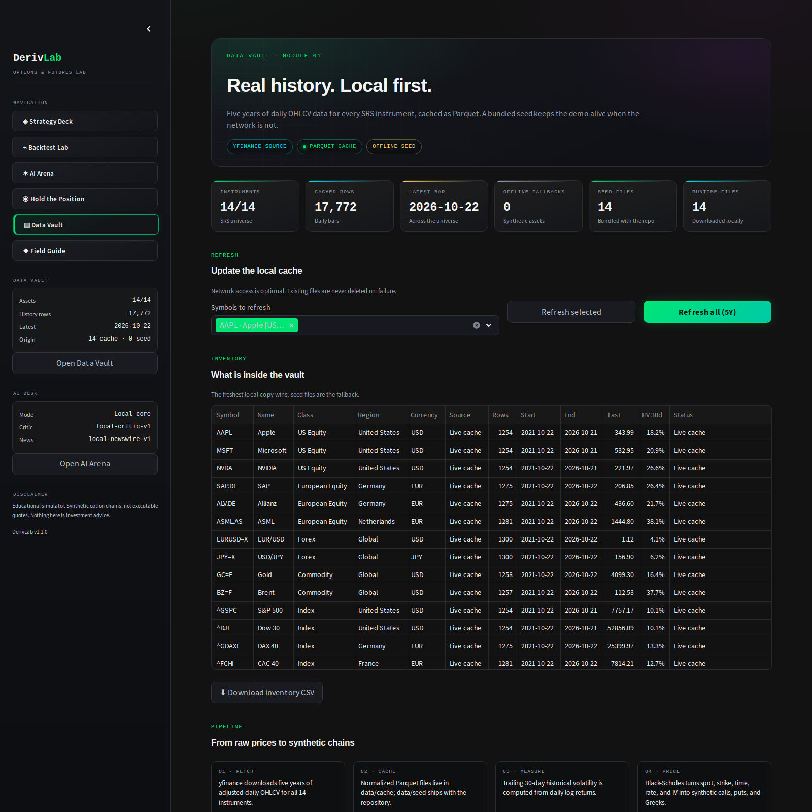

<div align="center">

# DerivLab

### The institutional trading floor you can hold in your hand.

**Learn options and futures by making decisions — not by memorising formulas.**

A cinematic, hands-on simulator where real market history becomes a playground,
three autonomous AI desks trade against you, and every decision has a
consequence you can see.

[**Try the offline demo →**](https://derivlab-pavyratzrx7won9iv4zmcg.streamlit.app/) ·
[**Watch the 25-second demo →**](docs/demo/derivlab-ai-arena.mp4) ·
[**Explore the documentation →**](https://github.com/SergeyGer/DerivLab/wiki) ·
[**Quick Start**](#-quick-start)

[](https://github.com/SergeyGer/DerivLab/actions/workflows/ci.yml)
[](https://github.com/SergeyGer/DerivLab/actions/workflows/codeql.yml)
[](https://github.com/SergeyGer/DerivLab/wiki/Testing-and-CI)
[](LICENSE)

[](https://www.python.org/)
[](https://streamlit.io/)
[](https://www.backtrader.com/)
[](https://www.docker.com/)
[](https://github.com/SergeyGer/DerivLab/wiki/AI-Model-Guide)

[](https://derivlab-pavyratzrx7won9iv4zmcg.streamlit.app/)
[](https://github.com/SergeyGer/DerivLab/pkgs/container/derivlab)

</div>

<p align="center">
  <a href="docs/demo/derivlab-ai-arena.mp4">
    
  </a>
</p>

<p align="center">
  <em>Live AI Arena · three autonomous desks · a real OpenAI critique · one historical tape.</em>
</p>

---

## Start here

Choose the path that matches the time you have.

| I want to… | Time | What you get | Start |
|---|---:|---|---|
| **See it working** | **2 min** | A live AI Arena, one historical cycle, a verdict and a news wire | [Try the live demo](https://derivlab-pavyratzrx7won9iv4zmcg.streamlit.app/) · [Watch the film](docs/demo/derivlab-ai-arena.mp4) |
| **Learn the strategies** | **20 min** | Covered calls, straddles, condors, basis — and the risk behind each one | [Strategy Deck](#1-strategy-deck--start-with-a-playbook) · [Feature Tour](https://github.com/SergeyGer/DerivLab/wiki/Feature-Tour) |
| **Run or deploy it** | **30 min** | A local terminal, a GHCR one-liner, or a Streamlit widget | [Quick Start](#-quick-start) · [Deployment](https://github.com/SergeyGer/DerivLab/wiki/Deployment) |

> New here? Start with the **2-minute** path, then use the 20-minute path for the
> vocabulary and intuition. You never need an API key.

---

## The problem with learning derivatives

Most people meet options through a wall of formulas, Greeks, and warnings.

They memorise “theta decay” without ever feeling a position bleed overnight.
They read about assignment without ever watching a short call get breached.
They learn risk management in theory — and then freeze when a real drawdown
appears on the screen.

**DerivLab turns those abstract ideas into a story you can play.**

You choose a strategy. You size the position. You watch the market move.
And then three AI fund managers show you what they would have done differently.

No live money. No broker account. No expensive data feed. Just the decisions,
the consequences, and the feedback loop that makes the lesson stick.

---

## What if the market talked back?

The centrepiece of DerivLab is the **AI Arena**.

You and three autonomous desks start with the same capital on the same
historical scenario. Each desk reads the regime, chooses its own strategy, and
trades the tape. At the end, a rival fund manager reviews your performance —
and the wire prints the story.

| Desk | Personality | What it wants to prove |
|---|---|---|
| **◈ AlphaVanguard AI** | The institutional relative-value manager | Discipline and risk-adjusted carry beat raw directional bets. |
| **⚡ VoltHawk AI** | The volatility specialist | The regime — not the direction — is the real edge. |
| **⛓ BasisDyne AI** | The carry and basis desk | Structural carry can survive even when premium selling struggles. |

The live demo runs **OpenAI `gpt-4.1`** for AlphaVanguard’s review and
**`gpt-4.1-mini`** for the cyberpunk NewsWire. The app always shows the exact
model in play. Without an API key, deterministic local models take over
automatically — every screen still works, offline.

> **The review is not generic.** It sees your return, drawdown, Sharpe, premium,
> the winning desk, the IV spikes, the strike breaches, and the assignments —
> then explains, in plain institutional language, what you got right and what
> you missed.

<p align="center">
  
</p>

[Explore the AI system →](https://github.com/SergeyGer/DerivLab/wiki/AI-Agents) ·
[Model recommendations →](https://github.com/SergeyGer/DerivLab/wiki/AI-Model-Guide)

---

## One terminal. Six ways to learn.

### 1. Strategy Deck — start with a playbook

Five strategies, explained like a field guide: basis arbitrage, covered calls,
cash-secured puts, long straddles, and iron condors. Each card gives you the
mechanics, the ideal market, the risk profile, and the failure modes — before
you risk a single simulated dollar.

<p align="center">
  
</p>

### 2. Backtest Lab — see the shape of the risk

Turn a playbook into a position. Change the strike, the expiry, the volatility,
the fees, and the capital. Watch the payoff profile and the historical equity
curve respond together. Then read the numbers that matter: return, drawdown,
Sharpe, Sortino, win rate, premium, and fees.

<p align="center">
  
</p>

### 3. AI Arena — trade against the machine

Four desks. One tape. A ranked leaderboard, a tactical review, a trigger
timeline, and a NewsWire written for the closing bell. This is where strategy
becomes competition — and competition becomes memory.

### 4. Hold the Position — manage a live scenario

The market moves one simulated day per second. Alerts fire. The short strike
gets breached. You can **roll**, **hold**, or **liquidate**. There is no undo
button, only the next decision and the debrief.

<p align="center">
  
</p>

### 5. Data Vault — real history, local first

Fourteen instruments, five years of daily history, and a transparent provenance
panel. The bundled seed keeps the demo alive when the network is not. Refresh
when you want newer data; the app tells you exactly what it is using.

<p align="center">
  
</p>

### 6. Field Guide — the vocabulary, without the fog

Delta, gamma, theta, vega, contango, assignment, rolling, max drawdown — the
language of derivatives, written for humans. Learn the words before the market
uses them against you.

---

## A 10-minute first session

1. **Open the Strategy Deck.** Pick **Covered Call** and read the card.
2. **Go to the Backtest Lab.** Keep Apple, 30 days, 5% out of the money. Look at
   the payoff and the equity curve. Change the volatility and watch the shape
   move.
3. **Open the AI Arena.** Run the 2022 Rate Shock scenario. See where you rank,
   read AlphaVanguard’s critique, and open the NewsWire.
4. **Play Hold the Position.** Launch the same scenario, fast-forward to the
   first alert, and make a call: roll, hold, or liquidate.
5. **Finish in the Field Guide.** Look up the one term you did not know.

That is the whole loop: **learn → shape → compete → decide → understand.**

---

## Why it stays with you

**You feel the risk, not just the formula.**
A drawdown is abstract until it is your portfolio on the screen.

**You get a rival, not a rubber stamp.**
AlphaVanguard does not flatter you. It compares your decisions with its own,
names the missed strikes, and tells you what a disciplined desk would have done.

**You see the whole story.**
The strategy, the payoff, the path, the trigger, the verdict, and the headline
live in one coherent world.

**It is genuinely beautiful.**
A dark, neon financial-terminal aesthetic makes a dense subject feel like
something you want to explore.

---

## Built for curious people

- **Students and self-taught traders** who want intuition before jargon.
- **Educators** who need a memorable live demo for options and risk.
- **Quant teams** who want a safe, visual sandbox for strategy conversations.
- **AI enthusiasts** who want to see agents do something more interesting than
  chat.
- **Anyone** who has ever wondered what a covered call actually feels like when
  the stock runs against it.

---

## Private by default. Honest by design.

- **No broker connection.** Nothing here can place a live order.
- **No market-data subscription.** The demo ships with a historical seed.
- **No account required.** Run it locally and keep your data on your machine.
- **No AI key required.** Local deterministic models power the full experience.
  Add a key only when you want live model prose.
- **No black box.** Every report is grounded in the metrics and triggers shown
  on the screen.

[Read the security notes →](https://github.com/SergeyGer/DerivLab/wiki/Security)

---

## 🚀 Quick Start

### ⚡ One command. No clone. No build.

The image is published to GitHub Container Registry. If Docker is installed:

```bash
docker run --rm -p 8501:8501 ghcr.io/sergeyger/derivlab:latest
```

Open **http://localhost:8501**. The image runs the bundled seed and the
deterministic local AI models; **no API key is required**.

> Prefer a zero-install widget? Use the
> [**Try the offline demo**](https://derivlab-pavyratzrx7won9iv4zmcg.streamlit.app/)
> button: Streamlit Community Cloud builds the app from GitHub and runs it with
> local models. The first deploy requires authorizing Streamlit with GitHub.

### Build from source

```bash
git clone https://github.com/SergeyGer/DerivLab.git
cd DerivLab
docker compose up --build
```

- First source build takes a few minutes; later starts are fast.
- The demo works without internet access thanks to the bundled seed.
- The AI Arena works immediately with local models.
- To use a live OpenAI model, add your key to a local `.env` and restart.
  The screen will show the exact model in use.

> **Prefer VS Code?** A complete Dev Container is included. See
> [Getting Started](https://github.com/SergeyGer/DerivLab/wiki/Getting-Started)
> for the Dev Container path, local development, and data refresh commands.

[Full installation & deployment guide →](https://github.com/SergeyGer/DerivLab/wiki/Deployment)

---

## Documentation

The README is the story. The **Wiki** is the manual.

| I want to… | Read |
|---|---|
| Install, run, and refresh data | [Getting Started](https://github.com/SergeyGer/DerivLab/wiki/Getting-Started) |
| Tour every screen | [Feature Tour](https://github.com/SergeyGer/DerivLab/wiki/Feature-Tour) |
| Understand the AI desks and the async bridge | [AI Agents](https://github.com/SergeyGer/DerivLab/wiki/AI-Agents) |
| Choose a model for the critic and the wire | [AI Model Guide](https://github.com/SergeyGer/DerivLab/wiki/AI-Model-Guide) |
| Understand how LLM output is validated and grounded | [LLM quality & reliability](docs/LLM-QUALITY.md) |
| Understand the engine, data, and strategy math | [Architecture](https://github.com/SergeyGer/DerivLab/wiki/Architecture) |
| Run the tests, CI, CodeQL, and coverage | [Testing & CI](https://github.com/SergeyGer/DerivLab/wiki/Testing-and-CI) |
| Deploy it for a team | [Deployment](https://github.com/SergeyGer/DerivLab/wiki/Deployment) |
| Read the architecture decisions | [ADR index](docs/adr/README.md) |
| Understand the documentation system | [Documentation infrastructure](docs/DOCUMENTATION.md) |
| Check performance, runtime, and model compatibility | [Compatibility & version matrix](docs/COMPATIBILITY.md) |
| Read release-specific snapshots | [Versioned documentation](docs/versions/README.md) |
| Plan a release | [Versioning & releases](docs/VERSIONING.md) |
| Know who maintains the docs | [Documentation owners](docs/OWNERS.md) |
| See what is planned | [Roadmap issue #17](https://github.com/SergeyGer/DerivLab/issues/17) |
| Fix a problem | [Troubleshooting](https://github.com/SergeyGer/DerivLab/wiki/Troubleshooting) |

**Docs version:** v1.2.0 · **Last verified:** 2026-10-23 · **Owner:** [@SergeyGer](https://github.com/SergeyGer)

> **Did this page help?** [Send documentation feedback](https://github.com/SergeyGer/DerivLab/issues/new?template=docs-feedback.yml) — broken link, missing step, or wording issue.

---

## What DerivLab is not

DerivLab is an **educational simulator**. It uses synthetic option chains and
historical market data; it does not show executable quotes, real order books, or
live brokerage fills. The AI desks are simplified institutional personas, and
LLM-generated commentary can be wrong.

**This is not investment advice, and nothing in this repository is a
recommendation to trade.** Treat every result as a lesson about risk — not a
forecast.

---

## License

Released under the [MIT License](LICENSE).

Built with curiosity, a dark terminal, and a healthy respect for drawdowns.
