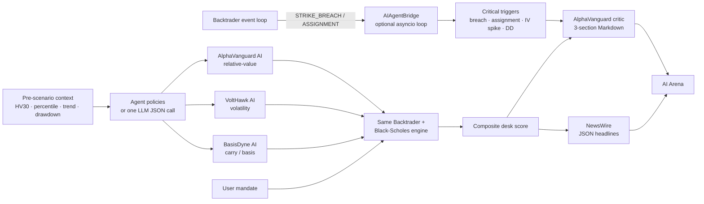

# AI Agents & Model Guide

DerivLab’s AI Arena turns the simulator into an adversarial sandbox: three
autonomous desks trade the same historical scenario as the user, then
AlphaVanguard AI reviews the cycle and NewsWire prints the tape.

The AI layer is **optional**. With no API key, the app uses deterministic local
models named in the UI. With a key, it routes decisions, critique, and news to
configured LLMs, validates their output, and falls back automatically on any
failure.

---

## Architecture



Key modules:

| Module | Responsibility |
|---|---|
| `derivlab/agents/llm.py` | Provider settings, model catalog, OpenAI-compatible and Anthropic HTTP calls, safe failure results |
| `derivlab/agents/personas.py` | Three desk personas, pre-simulation market context, deterministic policies, LLM decision prompt and validation |
| `derivlab/agents/bridge.py` | Async event bridge from Backtrader to the agent layer |
| `derivlab/agents/commentary.py` | Strict three-section AlphaVanguard report, cyberpunk NewsWire, JSON validation, local fallbacks |
| `derivlab/agents/arena.py` | Four-desk simulation, ranking, trigger extraction, model stack, report payload |
| `derivlab/agents/parsing.py` | Tolerant JSON extraction from fenced or chatty model responses |

---

## The three desks

| Desk | Persona and policy |
|---|---|
| **AlphaVanguard AI** | Institutional relative-value PM. Sells premium with the trend when volatility is high, rotates to delta-neutral basis when trend and volatility conflict, and uses defined-risk condors when volatility is cheap. |
| **VoltHawk AI** | Volatility arbitrage. Buys straddles when volatility and trend are expanding, sells iron condors when volatility is compressed and the tape is range-bound. |
| **BasisDyne AI** | Carry and basis. Harvests synthetic futures basis across the curve and keeps directional risk close to zero. |

The context used for decisions is computed **strictly before the scenario start**
(no lookahead): HV30, HV percentile over the trailing regime, 20/60-day trend,
120-day drawdown, and a volatility ratio. All four desks share the same capital
and scenario.

---

## Model roles

The app exposes three logical roles:

| Role | What it does | Output contract |
|---|---|---|
| **Decision model** | Chooses strategy, tenor, strike offset, wing width, basis premium, and rationale for all three desks | One JSON object keyed by agent, validated and clamped; fallback per agent |
| **Critic model** | AlphaVanguard performance review | Clean Markdown with exactly three required sections; fallback if headings are missing |
| **News model** | NewsWire | JSON array of 3–5 items with tag, headline, detail, severity; fallback if invalid |

Each role can use a different model. This lets you spend on the critic while using
a cheap, fast model for headlines.

### Recommended starting points

| Role | Primary | Alternatives | Why |
|---|---|---|---|
| **Critic** | **OpenAI GPT-5** | Anthropic Claude Sonnet 4.5, Google Gemini 2.5 Pro | Best multi-metric reasoning, nuanced risk critique, and strict Markdown/table discipline. |
| **News** | **OpenAI GPT-5 mini** | Claude Haiku 4.5, Gemini 2.5 Flash | Latency and cost matter more than deep reasoning for four headlines. |
| **Decisions** | **Deterministic local policy** | GPT-5 mini with JSON mode, Claude Haiku 4.5, Qwen3-32B | Reproducible, auditable, and free by default. LLM decisions are opt-in and validated. |
| **Offline/private** | **Qwen3-32B via Ollama/vLLM** | Llama 3.3 70B, Mistral Small 3 | No data leaves your machine, no per-call cost; sufficient for commentary/news. |

Model names are examples, not hard dependencies. Use the latest available
snapshot from your provider. The app displays the **actual** model ID returned by
configuration, or the local model name when no key is configured.

---

## Configuration

The client is provider-agnostic and only depends on `requests`.

### OpenAI

```bash
export DERIVLAB_LLM_PROVIDER=openai
export DERIVLAB_LLM_API_KEY=sk-...
export DERIVLAB_LLM_BASE_URL=https://api.openai.com/v1
export DERIVLAB_DECISION_MODEL=gpt-5-mini
export DERIVLAB_CRITIC_MODEL=gpt-5
export DERIVLAB_NEWS_MODEL=gpt-5-mini
```

### Anthropic

```bash
export DERIVLAB_LLM_PROVIDER=anthropic
export DERIVLAB_LLM_API_KEY=sk-ant-...
export DERIVLAB_CRITIC_MODEL=claude-sonnet-4-5
export DERIVLAB_DECISION_MODEL=claude-haiku-4-5
export DERIVLAB_NEWS_MODEL=claude-haiku-4-5
```

### Ollama / vLLM / LM Studio (no key)

```bash
export DERIVLAB_LLM_PROVIDER=ollama
export DERIVLAB_LLM_BASE_URL=http://host.docker.internal:11434/v1
export DERIVLAB_LLM_MODEL=qwen3:32b
```

### Docker Compose

Compose reads these variables from the host environment or a gitignored `.env`
file. Restart the app after changing them:

```bash
docker compose up -d --build
```

Because environment variables are visible to `docker inspect`, production
deployments should use Docker secrets or inject credentials at runtime rather than
committing them. The app never logs the key or renders it in the UI.

---

## Validation and fallback behavior

- No key / provider local → **no network request** is made; the local models run.
- HTTP error, timeout, empty response, malformed JSON, or missing report sections
  → the local critic/news/policy is used for that call, with the reason shown in
  the **Model stack** tab.
- LLM decisions are clamped to allowed strategies, tenors, strike offsets, wing
  widths, and basis premiums.
- Report sections are validated; the strict headings are:
  - `### 📊 Performance Summary & Comparative Analysis`
  - `### 🔍 Tactical Critique of User's Performance`
  - `### 💡 Elite Quant Recommendation`
- News items are bounded in length, severity is normalized, and at least three
  valid items are required before the model output is accepted.
- LLM output is rendered as untrusted Markdown (no raw HTML).

---

## The async bridge

`BacktestController` emits events when a short option strike is breached or an
option is assigned. The event flows into `AIAgentBridge`:

```python
from derivlab.agents.bridge import AIAgentBridge

bridge = AIAgentBridge(event_loop=loop)  # loop optional
run_backtest("AAPL", frame, config, event_bridge=bridge)

# If a loop is running:
#   asyncio.run_coroutine_threadsafe(process_market_shock(payload), loop)
# Otherwise events are retained in-process for the UI/report layer.
```

This matches the SRS 5.2 integration pattern while keeping the simulation
deterministic. A production deployment can replace the in-memory queue with a
message bus without changing the backtester.

---

## Extending the agents

1. Add a new `AgentPersona` in `personas.py` and a policy branch.
2. Add it to `AGENTS`; the arena/UI/cards pick it up automatically.
3. Add a model role if needed and expose it through `LLMSettings`.
4. Add tests under `tests/test_agents.py` for the policy, arena run, and UI.

Keep all prompts in English, keep deterministic fallbacks, and never let an LLM
failure raise into the Streamlit UI.

---

## What this is not

The arena is an educational simulation of institutional competition. The
personas are simplified policies, the option chain is synthetic, and LLM prose can
be wrong. Nothing here is investment advice.
