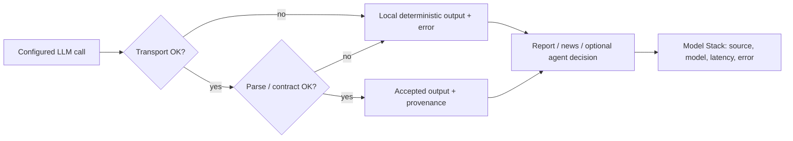

# LLM Quality & Reliability

**Last verified:** 2026-10-23
**Applies to:** DerivLab 1.2.0
**Owner:** [@SergeyGer](https://github.com/SergeyGer)

DerivLab is **local-first**. LLM output is an optional narrative and
decision-assist layer, never a trusted source of truth. A model response is either
accepted through a small set of explicit contracts or rejected in favour of a
deterministic local result.

This page describes what is actually measured, where the checks live, and which
risks remain.

---

## The one-paragraph version

Every configured LLM call returns a normalized `LLMResult`. Transport errors,
empty responses, malformed JSON, missing report sections, too few news items, or
invalid agent strategies do not raise into the UI: they fall back to the local
critic/newswire/policy and expose the reason. Agent decisions are clamped to the
allowed strategy, tenor, strike-offset, wing, and basis ranges. The reviewer
report and NewsWire are **not fed back into the simulation**, so an invented
number cannot change a trade. The project does **not** claim automated factual
verification of prose; that residual risk is handled by grounding prompts, UI
disclaimers, local fallbacks, and human review.

---

## Acceptance pipeline



There is no numeric “LLM quality score”. The acceptance decision is binary per
artifact: **contract pass** or **local fallback**. This is deliberate: a
structural score would create false confidence in semantic truth.

---

## Quality gates

| Gate | Automated? | What passes | Where |
|---|---|---|---|
| Configuration | ✅ | Provider, base URL, key, and non-local model IDs are present; otherwise no network call | `LLMSettings.enabled` in `derivlab/agents/llm.py` |
| Transport | ✅ | HTTP 2xx, non-empty content, timeout respected | `LLMClient.generate`, `_openai_compatible`, `_anthropic_messages` |
| Normalization | ✅ | Every result carries `ok`, `model`, `provider`, `source`, `latency_ms`, `error` | `LLMResult` |
| JSON extraction | ✅ | Fenced or chatty JSON is extracted; invalid JSON returns `None` | `extract_json_object`, `extract_json_array` in `derivlab/agents/parsing.py` |
| Decision schema | ✅ | Allowed strategy and tenor; bounded numeric fields; invalid persona falls back per agent | `normalize_agent_decision`, `_parse_llm_decisions` in `derivlab/agents/personas.py` |
| Report contract | ✅ | All three required headings are present | `validate_report` in `derivlab/agents/commentary.py` |
| News contract | ✅ | Valid JSON array, 3–5 usable items, normalized fields/severity | `generate_news`, `_normalize_news_item` |
| Grounding | ⚠️ partial | Prompts restrict the model to the supplied payload; no retrieval or web access | `ALPHAVANGUARD_SYSTEM_PROMPT`, `NEWS_SYSTEM_PROMPT`, `build_decision_prompt` |
| Factual truth | ❌ not automatic | The project does not assert that every sentence is true | Residual risk, documented below |
| Prose quality | ❌ human review | Accuracy, specificity, actionability, tone | Reviewer rubric below |
| Reproducibility | ✅ local path | Local outputs are deterministic | `local_report`, `local_news`, `policy_decision` |

---

## Report: AlphaVanguard

The report path is:

1. Build a deterministic local report first (`local_report`).
2. If no client is enabled, return it.
3. Otherwise call the critic model with `ALPHAVANGUARD_SYSTEM_PROMPT`.
4. Reject the LLM report if:
   - the call failed;
   - the response was empty;
   - any of the three exact headings is missing (`validate_report`).
5. On rejection, return the local report with `source="local"` and the error
   message.
6. On acceptance, return `source="llm"` with the actual model, provider, and
   latency.

The prompt requires exactly three sections in order:

```text
### 📊 Performance Summary & Comparative Analysis
### 🔍 Tactical Critique of User's Performance
### 💡 Elite Quant Recommendation
```

**Implementation detail:** `validate_report` is deliberately a small
presence-based guard. It does not claim to validate every claim or numeric
value. The prompt says “Use only the supplied numbers”; the report is not used
as an input to any backtest. If the model adds extra prose outside the sections,
the UI may display it; the contract guard only guarantees the three required
headings.

**Why local first:** if the provider is down, rate-limited, refuses, returns
Markdown instead of the expected structure, or omits a section, the user still
sees a complete, grounded review. The fallback is labelled in the UI and in the
Model Stack tab.

---

## NewsWire

`generate_news` accepts only a JSON array with 3–5 usable objects. Each item is
normalized:

- `tag` — upper-cased, truncated to 24 characters;
- `headline` — required, truncated to 120 characters;
- `detail` — required, truncated to 260 characters;
- `severity` — `high`, `medium`, or `low`; unknown values become `medium`.

If the model returns fewer than three valid items, or a non-array, the
deterministic four-item local wire is used. The UI marks the fallback and the
error reason in the Model Stack tab.

---

## Agent decisions: bounded autonomy

LLM-directed agent mandates are opt-in. When enabled, one JSON call covers all
three personas. The parser applies these rules in
`normalize_agent_decision`:

| Field | Rule |
|---|---|
| `strategy_key` | Must be one of `covered_call`, `cash_secured_put`, `basis_trade`, `long_straddle`, `iron_condor`; otherwise the policy result for that agent |
| `tenor_days` | Must be 30, 60, or 90; otherwise the policy tenor |
| `strike_offset_pct` | Clamped to −25…25; forced to 0 for basis; absolute value clamped to 2…20 for condors |
| `wing_width_pct` | Clamped to 1…10 |
| `basis_pct` | Clamped to 0…15 |
| `rationale` | Falls back to the policy rationale if missing; truncated to 320 characters |

Missing personas fall back individually. Invalid JSON falls back for all three.
The LLM cannot introduce a new strategy, a different asset, leverage, or an
unbounded parameter. These bounds protect the simulation from malformed output;
they do **not** claim that a legal mandate is a profitable one.

The default remains the deterministic policy in `policy_decision`, which uses
only the pre-scenario context.

---

## Grounding and non-interference

- `build_market_context` uses only bars before the scenario start; the decision
  prompt receives that context.
- The critic/news payload is assembled from the actual `BacktestResult` objects:
  NAV, return, drawdown, Sharpe, premium, leaderboard, and
  `extract_critical_triggers`.
- The system prompts say “use only supplied numbers”, “do not invent prices,
  dates, or trades”, and “no investment advice”.
- The critic and wire outputs do not feed the backtest, the user portfolio, or the
  scoring loop.
- Optional LLM agent decisions affect only simulated agent mandates, after the
  clamp/fallback rules above. There is no broker connection and no live order.

This prevents a model hallucination from silently rewriting the simulation. It
does **not** prove that the prose is factually correct; the report can still
misinterpret a supplied metric.

---

## Runtime observability

The UI must make model provenance visible. `ArenaResult.llm_status` records:

- whether the LLM was configured and enabled for the run;
- the provider and model stack;
- the decision call result;
- report and news `public_dict()` values: model, provider, source, latency, error.

The **Model Stack** tab shows one row per stage, including:

- **Source** (`llm` / `local`);
- **Latency**;
- **Error** (timeout, invalid JSON, missing sections, provider error).

When a fallback occurs, `run_arena` updates the visible stack to the local model
and provider. A user never sees “gpt-4.1” as the active critic if the actual
accepted output came from the local critic.

---

## Automated tests

The agent suite is offline and uses mocked HTTP. The full suite is run with:

```bash
pytest -q
pytest -q tests/test_agents.py
```

The 26 agent tests include the quality contracts:

| Test | Contract protected |
|---|---|
| `test_openai_client_parses_response` | Provider response normalization |
| `test_openai_client_retries_max_completion_tokens` | API parameter compatibility |
| `test_openai_client_failure_falls_back` | Network failure → local result |
| `test_anthropic_client_parses_response` | Anthropic response shape |
| `test_json_parsing_helpers` | Fenced/chatty JSON extraction |
| `test_normalize_agent_decision_clamps` | Strategy/tenor/parameter bounds |
| `test_decide_agents_llm_path` | Valid JSON → per-agent LLM mandates |
| `test_decide_agents_invalid_json_falls_back` | Invalid JSON → local policies |
| `test_generate_report_llm_and_fallback` | Missing headings → local critic |
| `test_news_invalid_json_falls_back` | Invalid wire JSON → local newswire |
| `test_arena_llm_path` | Full mocked LLM Arena path and model stack |
| `test_arena_local_run` | Deterministic offline Arena |

`tests/conftest.py` forces the local provider so a developer's `.env` key never
causes network traffic or cost during tests. CI uses the same offline path.

---

## Human review rubric

Automated gates cannot judge whether the analysis is *useful*. For a release or
a model change, a reviewer should check:

1. **Numeric accuracy** — do the return, drawdown, Sharpe, premium, and
   leaderboard references match the payload?
2. **Causal specificity** — does the critique name the actual trigger
   (breach/assignment/IV spike) rather than generic advice?
3. **Actionability** — is the recommendation implementable (strike distance,
   hedge, roll rule)?
4. **No invented facts** — no prices, dates, trades, or model names that were not
   supplied.
5. **Contract cleanliness** — exactly the three sections, no raw HTML, no
   investment advice.

The local report is the reference output for the same payload.

---

## Failure modes and responses

| Failure | Detection | Response |
|---|---|---|
| Timeout / connection error | `requests.RequestException` | `LLMResult(ok=False)` → local output; error surfaced |
| HTTP 4xx/5xx | status check | local output; provider message clipped |
| Empty response | `text.strip()` check | local output |
| Markdown/fenced JSON | `strip_code_fences` + parser | extracted if valid; otherwise local |
| Invalid decision JSON | `extract_json_object` → `None` | all policies |
| Invalid persona object | per-agent validation | policy fallback for that agent |
| Out-of-range parameter | clamps | bounded value or policy fallback |
| Missing report section | `validate_report` | local critic |
| Too few news items | count check | local newswire |
| Model lies about a metric | no automatic numeric proof | residual risk; grounding prompt, UI context, human review |
| Model output HTML | rendered as Markdown without raw HTML | no script/HTML execution |
| Provider API key leak | not included in results/UI/logs | keys stay in settings/environment |

---

## What is not claimed

- **No LLM-as-judge.** A second model is not used to grade the first; that would
  add cost, non-determinism, and another failure mode.
- **No automatic truth score.** Passing the contract means “safe to display and
  structurally valid”, not “financially correct”.
- **No guarantee of alpha.** LLM-selected mandates are bounded simulations, not
  investment advice and not an execution system.
- **No external retrieval.** The model sees only the supplied payload, reducing
  prompt-injection surface but also limiting factual coverage.

The correct interpretation is: **LLM output is an optional, bounded narrative
layer with deterministic fallback; the simulation’s accounting and the user’s
portfolio remain independent of it.**

---

## Code map

| File | Responsibility |
|---|---|
| [`derivlab/agents/llm.py`](../derivlab/agents/llm.py) | Settings eligibility, HTTP clients, `LLMResult`, timeouts, provider errors |
| [`derivlab/agents/parsing.py`](../derivlab/agents/parsing.py) | Tolerant JSON object/array extraction |
| [`derivlab/agents/personas.py`](../derivlab/agents/personas.py) | Decision prompt, deterministic policy, clamps, per-agent fallback |
| [`derivlab/agents/commentary.py`](../derivlab/agents/commentary.py) | Report/news prompts, validators, local reports/news, fallback |
| [`derivlab/agents/arena.py`](../derivlab/agents/arena.py) | Payload construction, Arena orchestration, model stack, `llm_status` |
| [`derivlab/ui.py`](../derivlab/ui.py) | Model Stack tab, fallback captions, visible provenance |
| [`tests/test_agents.py`](../tests/test_agents.py) | Offline contract tests and mocked LLM paths |

## Verify it yourself

```bash
pytest -q tests/test_agents.py
python scripts/validate_docs.py
```

Related: [AI Agents](https://github.com/SergeyGer/DerivLab/wiki/AI-Agents) ·
[AI Model Guide](https://github.com/SergeyGer/DerivLab/wiki/AI-Model-Guide) ·
[Compatibility & Versions](https://github.com/SergeyGer/DerivLab/wiki/Compatibility-and-Versions)
